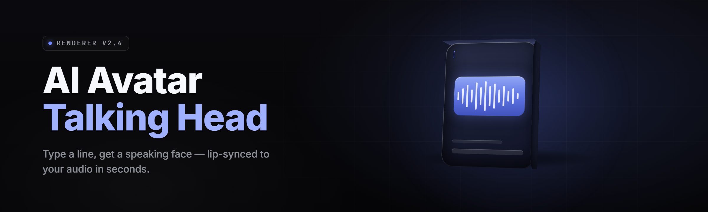

  
  
  

  

  
  
  

---

**Avatar Forge — Talking-Head Generator (2026)**  
Real-time neural avatar synthesis on your desktop. Drop in a photo or a mesh, type a script, get a talking head. No cloud, no account, no per-minute billing.

---

## 🧾 What You Need Before You Start

Before the first run, confirm the following. The `.exe` is a self-contained bundle — it ships its own runtime, ONNX execution provider, model weights loader, FACS blend-shape rig and audio driver bridge. Nothing else to install.

- **OS:** Windows 10 21H2 or Windows 11 (x64)
- **GPU:** NVIDIA GTX 1060 6GB minimum; RTX 3060 12GB recommended for real-time 30fps
- **CPU fallback:** Ryzen 5 3600 / i5-10400 or better — expect 4–6 fps
- **Disk:** 9 GB for the `.exe` bundle + model pack; 22 GB recommended if you keep multiple avatar packs
- **Audio:** any WASAPI-compatible input for live lip-sync; .wav / .mp3 for offline render
- **Rights:** no admin required for portable mode; admin only if you install into `C:\Program Files\`

> First launch extracts models to `%LOCALAPPDATA%\AvatarForge\models\`. Allow 60–90 seconds on first run.

---

## 🧠 What is Avatar Forge

A glossary of the moving parts, so the terms in the rest of this page land clean.

| Term | Explanation |
|---|---|
| **Talking head** | A 2D or 3D head rig whose jaw, lips, brows and eyes are driven by audio or text-to-speech in real time. |
| **Blend shape / FACS AU** | Facial Action Coding System action units — the low-level muscle-ish controls the generator animates (jawOpen, mouthPucker, browRaiseInner, etc.). |
| **Lip-sync (viseme mapping)** | Phoneme-to-mouth-shape conversion. "M", "B", "P" close the lips; "A", "E", "I" open wide. |
| **Head pose track** | The 6-DoF rotation + translation applied to the avatar's neck/root, inferred from audio prosody or from a webcam or from a manual curve. |
| **Avatar pack** | A folder containing the base mesh/photo, texture atlas, rig definition, and voice profile. Distributable as a `.afpack`. |
| **Neural renderer** | The diffusion/GAN pass that takes the rig state and produces the final photoreal or stylized frame. |
| **TTS bridge** | Text-to-speech frontend that outputs both waveform and phoneme timings — the generator uses both to drive lips. |

**Why builders grab this over a cloud service:**

- Runs fully offline — no upload of your face, your voice, or your script
- Renders a 1080p talking head at 24–30 fps on a mid-range RTX card
- Your avatar pack is a folder you own; export, back it up, ship it to friends
- No subscription. No watermark. No per-character TTS meter ticking.
- Drives OBS, Zoom, Discord and Unity via Spout / NDI / virtual camera out of the box

---

## 🎬 The Problem

The talking-head generator space has been broken for hobbyists since day one. The pain is specific:

- Cloud generators charge per minute and lock your project behind an account — you build a character, then lose access to it.
- Research repos assume you have a CUDA toolchain, a Python env, and three hours to fight `torch` wheels.
- Web-based demos cap at 720p, add a watermark, and refuse to export audio + video as a clean pair.
- Live avatar tools that *do* run locally are welded to one specific rig format — try to bring your own mesh and the pipeline breaks.
- No serious local tool ships real lip-sync *and* head-pose *and* eye-blink *and* TTS in one window. You end up gluing four tools together with ffmpeg.
- Existing tools dump everything to a temp dir; you can't find the frames, the audio, or the project file a week later.
- 3D avatar tools ignore 2D portrait workflows entirely — half the niche just wants a photo that talks.

---

## 🔧 The Solution

| Problem | How Avatar Forge handles it |
|---|---|
| Per-minute cloud billing | Fully local inference. Rendering a 10-minute clip costs zero credits and zero network calls. |
| Toolchain hell | Single `.exe`, self-contained bundle, no Python, no pip, no CUDA toolkit install. |
| Watermarks & 720p caps | No watermark, no resolution cap. Export up to 4K at your GPU's limit. |
| Locked rig formats | Ingest `.fbx`, `.glb`, `.obj`, `.vrm`, plus raw `.png`/`.jpg` portraits via the 2D portrait path. |
| Fragmented pipeline | One window: TTS → viseme track → head pose → blink/saccade → render → mux. |
| Lost outputs | Every project is a folder with `project.afp`, frames, audio, and `render.log`. Self-contained. |
| 2D vs 3D split | Two first-class paths. Pick "Portrait" or "Rigged 3D" at project creation; the node graph adapts. |

---

## ⚙️ Key Features

The full module matrix lives further down. This is the quick shape of what's in the box:

| Feature | Description | Benefit |
|---|---|---|
| **One-click portrait** | Drop a single face photo; auto-detects 68 landmark points and builds a driving rig. | Talk out of a photo in under 90 seconds. |
| **Real-time 30fps** | Optimized ONNX Runtime EP with CUDA/TensorRT kernels. | Live avatars for streams and calls, not just offline render. |
| **Neural TTS with timings** | Bundled TTS emits waveform + phoneme timings in one pass. | Lip-sync that matches the actual audio, not a guess. |
| **Head-pose from prosody** | Audio-only head motion inference — no webcam needed. | Natural head sway for offline VO workflows. |
| **Webcam driver mode** | Map your own face to the avatar live. | Vtubing, anonymized calls, mocap-lite. |
| **Virtual camera output** | DirectShow + Spout + NDI out. | Drops into OBS, Zoom, Discord, Teams. |
| **4K export** | Offline renderer at up to 3840×2160, ProRes / H.264 / H.265. | YouTube-ready masters without a second tool. |
| **Avatar pack `.afpack`** | Zip-style bundle for mesh + textures + rig + voice. | Share avatars with friends in one file. |
| **Node graph editor** | Rewire the pipeline: swap TTS, insert a de-noise node, branch outputs. | Power users only — the default graph just works. |

---

## 🚀 Quick Start

Five steps. If you can extract a zip, you can run this.

1. 📄 **Download** the release archive from the project's landing page.
2. 📦 **Extract** the archive to any folder you own — `D:\Tools\AvatarForge\` is fine. Do not extract into `Program Files` unless you're comfortable running as admin.
3. ▶️ **Run** the `.exe` from inside the extracted folder. First launch extracts model weights; keep the window open.
4. 🎤 **Choose a path** on the launch screen: *Portrait* (2D from a photo) or *Rigged 3D* (import a mesh). Give the project a folder.
5. 🎬 **Type or load a script**, hit *Generate Track*, then *Render*. Outputs land in your project folder.

  

---

## 🧩 Module Matrix

25 modules that make up the pipeline. Status reflects the current 2026 build.

| Module | Status | Description |
|---|---|---|
| `portrait_rig_builder` | ✅ Working | 68-landmark detection → blendshape-ready portrait rig. |
| `mesh_importer` | ✅ Working | FBX / GLB / OBJ / VRM with auto-bone-mapping to the standard head rig. |
| `texture_atlas_packer` | ✅ Working | Packs face textures, dedupes, outputs a single PNG + JSON map. |
| `tts_frontend_piper` | ✅ Working | Offline TTS; emits waveform + phoneme timings. |
| `tts_frontend_xtts` | ✅ Working | Voice-clone TTS; needs a 30s reference clip. |
| `phoneme_aligner` | ✅ Working | Aligns phoneme stream to audio if TTS doesn't provide timings. |
| `viseme_mapper` | ✅ Working | 44 phonemes → 14 mouth shape groups, configurable. |
| `prosody_head_pose` | ✅ Working | Head yaw/pitch/roll inferred from audio energy and pitch curve. |
| `webcam_face_driver` | ✅ Working | 30fps webcam → rig control, low-latency. |
| `eye_blink_saccade` | ✅ Working | Blink scheduler + micro-saccade generator. |
| `brow_emotion_layer` | ✅ Working | Rule-based + model-based emotion on brows and lids. |
| `neural_renderer_sd15` | ✅ Working | 2D portrait neural pass, SD1.5-based, ONNX EP. |
| `neural_renderer_sd21` | 🧪 Partial | Higher fidelity 2D pass; slower, still optimizing. |
| `mesh_rasterizer` | ✅ Working | Native 3D render path for rigged avatars. |
| `deformer_engine` | ✅ Working | Applies blendshapes + pose to the mesh each frame. |
| `scene_lights` | ✅ Working | Three-point rig presets + HDR env map input. |
| `background_pipeline` | ✅ Working | Solid, image, video, or transparent (alpha) backgrounds. |
| `node_graph_editor` | ✅ Working | Visual pipeline editor; JSON-backed. |
| `virtual_camera_out` | ✅ Working | DirectShow virtual cam. |
| `spout_out` | ✅ Working | Spout2 sender for OBS and Resolume. |
| `ndi_out` | ✅ Working | NDI 5 sender. |
| `audio_out_router` | ✅ Working | Maps rendered audio to a device or a virtual cable. |
| `muxer_ffmpeg` | ✅ Working | H.264 / H.265 / ProRes muxing, audio sync preserved. |
| `batch_renderer` | ✅ Working | CSV script-in, clip-out; queues overnight. |
| `afpack_manager` | ✅ Working | Import / export `.afpack` avatar bundles. |

---

## 🗂️ Feature Groups

Modules fall into five groups. Each group is a self-contained stage of the pipeline.

**🎙️ Speech — TTS & Alignment**
- Offline TTS with two engines (`piper`, `xtts`)
- Voice cloning from a 30-second reference clip
- Phoneme timing emitted on the same pass as waveform
- Language packs: EN, ES, PT, JA, DE, FR (subset shipped)
- Script import from `.txt`, `.srt`, `.csv`

**👄 Lip-Sync & Facial Motion**
- 44→14 viseme mapper with tuning panel
- Micro-expression layer (brow, lid, nostril)
- Blink scheduler with Poisson-distributed timing
- Saccade generator — eyes wander like real eyes do
- Emotion presets: neutral, warm, focused, concerned, amused

**🎥 Capture & Driving**
- Webcam driver at 30fps (any DirectShow camera)
- WAV / MP3 driving for offline VO
- Manual curve mode — hand-animate the rig on a timeline
- CSV import: per-frame FACS AU values

**🎨 Rendering**
- 2D portrait neural pass (SD1.5 / SD2.1)
- 3D mesh rasterizer with PBR shading
- 4K export path, ProRes 422 HQ
- Background pipeline: solid / image / video / alpha
- Motion blur toggle for offline renders

**🖥️ Output & Integration**
- DirectShow virtual camera
- Spout2 and NDI 5 senders
- Muxer with audio-sync guarantee (±1 frame)
- Batch renderer driven by CSV
- `.afpack` import/export

---

## 📊 Compatibility

Platform and pipeline compatibility matrix.

| Pipeline | Windows 10 | Windows 11 | CUDA EP | DirectML EP | CPU EP |
|---|---|---|---|---|---|
| 2D Portrait (SD1.5) | ✅ | ✅ | ✅ | ✅ | ✅ slow |
| 2D Portrait (SD2.1) | ✅ | ✅ | ✅ | 🧪 | ❌ |
| 3D Rigged Mesh | ✅ | ✅ | ✅ | ✅ | ✅ |
| Webcam Driver | ✅ | ✅ | ✅ | ✅ | ✅ |
| Virtual Camera Out | ✅ | ⚠️ needs OBS 30+ | — | — | — |
| Spout2 Out | ✅ | ✅ | — | — | — |
| NDI 5 Out | ✅ | ✅ | — | — | — |
| Batch Renderer | ✅ | ✅ | ✅ | ✅ | ✅ |

⚠️ On Windows 11, some older OBS installs need the DirectShow filter registered manually from the app's *Integrations* tab.

---

## 🔄 How It Compares

Fair framing — alternatives exist and they're fine tools. Here's where each one sits.

| Aspect | Cloud Talking-Head Services | Research Repo (Python) | **Avatar Forge** |
|---|---|---|---|
| Setup | Sign up, upload | Clone, cuda install, torch wheels | Extract, run `.exe` |
| Privacy | Your face on their server | Local | Local |
| Pricing | Per minute / per render | Free, your time | Free |
| Photo → talking head | Yes | Rarely | Yes |
| Rigged 3D import | No | Sometimes | Yes, first-class |
| Live output (OBS / Zoom) | No | No | Yes — Spout / NDI / vcam |
| Export resolution | Often capped, watermarked | Depends on your patch | Up to 4K |
| Head-pose inference | Cloud model | DIY | Built in |
| Batch mode | Paid tier | Script it yourself | CSV in the app |

---

## 🛠️ Installation

Three numbered sub-steps. Nothing else required.

1. **Download the release archive** from the project landing page. The archive contains the `.exe`, its runtime libraries, and the base model pack. Total size lands around 9 GB.

2. **Extract** to a folder you own. A short path helps (`D:\AF\`). The extractor must preserve the `models\` subfolder — extracting into a single flat directory will break model discovery on first run.

3. **Run** the `.exe`. On first launch the app writes to `%LOCALAPPDATA%\AvatarForge\`:
   - `models\` — dequantized weights
   - `cache\` — shader and kernel caches
   - `logs\` — `boot.log`, `render.log`
   You can point these at a different drive from *Settings → Paths* if your OS drive is tight.

---

## 🧪 Known Issues

Real ones from the current build, with the workaround.

| Issue | Solution |
|---|---|
| First render stalls at 0% for 30–60s | CUDA kernel compilation on first run. Let it finish; subsequent renders start cold in ~2s. |
| Virtual camera doesn't appear in Zoom | Zoom's camera list caches. Restart Zoom after first registration. |
| TTS voice cloning sounds metallic | Reference clip needs 30s of clean mono speech, no music, no reverb. Re-record. |
| 4K export OOM on 8GB cards | Drop to 1440p or enable *Tiled Render* in the export dialog. |
| Spout receiver in OBS shows a black frame | Receiver must be created after the sender starts. Start Avatar Forge first. |
| `.afpack` import fails on Windows 11 | Rare AV interference on zip extraction. Add the folder to exclusions. |

---

## ❓ FAQ

**Q: Do I need to install Python, CUDA, or anything else?**  
**A:** No. The `.exe` is a self-contained bundle. All you need is a Windows machine with a supported GPU (see System Requirements above).

**Q: Does this upload my face or my voice anywhere?**  
**A:** No network calls during generation. The app runs on your machine, offline. The only time it touches the network is if you manually check for updates from the *About* tab.

**Q: Can I use this with OBS / Streamlabs / Discord?**  
**A:** Yes. Enable *Virtual Camera* or *Spout2* in the *Outputs* tab. The virtual camera shows up in any app that lists webcams, including OBS, Discord, Zoom, Teams and Streamlabs.

**Q: What rig formats can I bring in?**  
**A:** FBX, GLB, OBJ and VRM for 3D; PNG and JPG for the 2D portrait path. VRM gets auto-mapped to the standard head rig — if you have a custom rig, use the *Rig Mapping* panel.

**Q: Can I clone my own voice?**  
**A:** Yes, with the `xtts` frontend. You need about 30 seconds of clean mono speech. Voice cloning runs entirely on your machine.

**Q: Is there a watermk or a resolution cap?**  
**A:** No watermark. Resolution is limited by your GPU memory — up to 4K on cards with 10GB+ VRAM.

**Q: Does it work with AMD or Intel GPUs?**  
**A:** Yes, via the DirectML execution provider. Performance is lower than CUDA but functional. CPU-only mode exists but is very slow (4–6 fps for a 720p talking head).

**Q: Where do exports land?**  
**A:** Every project is a folder. Video, audio, frames and a `render.log` all live inside it. Nothing is dumped to a mystery temp directory.

**Q: How big is the download?**  
**A:** Around 9 GB for the bundle plus base models. Additional avatar packs and voice packs add 1–3 GB each.

**Q: Do I need admin rights?**  
**A:** No, if you run it from a folder you own. Admin is only needed if you install under `C:\Program Files\`.

---

## 🧷 Usage Guidelines

A short, honest set of boundaries for how the community uses this.

| Allowed | Not allowed |
|---|---|
| Personal avatars for streaming, video, calls | Impersonating a real person without their consent |
| Voice cloning of *yourself* or a consenting collaborator | Voice cloning public figures to misrepresent them |
| Educational and research use of the pipeline | Using generated heads to commit fraud or harassment |
| Commercial video production with an avatar you built | Reselling the `.exe` or model pack as your own product |
| Modding, scripting and node-graph extensions | Bypassing any license or attribution requirement |

The project is MIT-licensed. Fork it, extend it, ship your own avatar packs.

---

## 📦 System Requirements

A clean grid to compare against your machine.

| Component | Minimum | Recommended |
|---|---|---|
| OS | Windows 10 21H2 (x64) | Windows 11 23H2 (x64) |
| GPU | GTX 1060 6GB | RTX 3060 12GB or better |
| VRAM | 6 GB | 12 GB+ |
| CPU | Ryzen 5 3600 / i5-10400 | Ryzen 7 5800X / i7-12700 |
| RAM | 16 GB | 32 GB |
| Disk | 12 GB free | 32 GB free (SSD) |
| Audio in | Any WASAPI device | Low-latency ASIO / WASAPI-Exclusive |
| Display | 1080p | 1440p+ |

---

## 🖱️ Usage Walkthrough

1. **Launch and pick a path.** *Portrait* for photo-to-talking-head; *Rigged 3D* if you have a mesh. The two paths share the back half of the pipeline.
2. **Load your avatar.** A photo, a mesh, or an `.afpack`. The rig builder runs automatically for photos.
3. **Load a script or attach audio.** Type a script and let TTS run, or drop a `.wav` / `.mp3` if you're driving the avatar from an existing voiceover.
4. **Tune the track.** The timeline shows the viseme track, head-pose curve and blink track as separate lanes. Nudge anything that reads wrong.
5. **Pick outputs.** Enable *Virtual Camera*, *Spout*, or just hit *Render to file*. Choose resolution, codec and background.
6. **Render.** Offline renders run at your GPU's pace. Batch mode queues a CSV of scripts overnight.

---

## 🧭 Table of Contents

- [What You Need Before You Start](#-what-you-need-before-you-start)
- [What is Avatar Forge](#-what-is-avatar-forge)
- [The Problem](#-the-problem)
- [The Solution](#-the-solution)
- [Key Features](#️-key-features)
- [Quick Start](#-quick-start)
- [Module Matrix](#-module-matrix)
- [Feature Groups](#️-feature-groups)
- [Compatibility](#-compatibility)
- [How It Compares](#-how-it-compares)
- [Installation](#️-installation)
- [Known Issues](#-known-issues)
- [FAQ](#-faq)
- [Usage Guidelines](#-usage-guidelines)
- [System Requirements](#-system-requirements)
- [Usage Walkthrough](#️-usage-walkthrough)

---

## 🎁 Get Avatar Forge

Everything above is what ships in the current 2026 build. If you've read this far and you want to try it, the path is short: download, extract, run. The pipeline handles the rest — photo or mesh in, a talking head out, on your own machine, with nothing uploaded anywhere.

  

---

Built for the hobbyist who wants a talking head *now* — not a research project to debug for a weekend. If you hit a wall, the *Known Issues* table above and the FAQ cover most of it. If you get something working that isn't in the matrix, that's the good kind of bug report to file.
